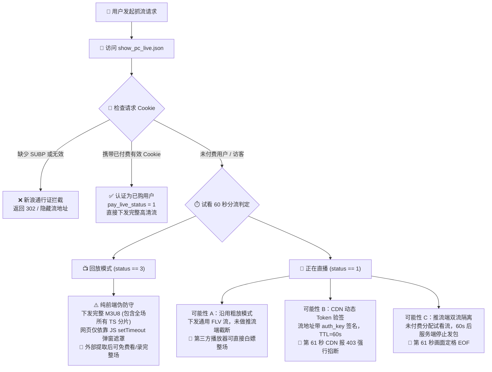

# 微博直播流地址提取、鉴权机制与付费绕过可能性深度分析

本文档汇总了对**微博直播（Weibo Live）**系统底层架构、鉴权机制（Cookie 构成）、付费直播间防守策略、以及是否可能“通过提取流地址绕过 60 秒试看限制”的完整技术分析与实测结论。

---

## 一、核心结论速览

| 场景 | 防守类型 | 是否能提取流地址？ | 能否绕过付费看/录完整场？ | 技术原理简述 |
| :--- | :--- | :--- | :--- | :--- |
| **已结束的付费直播（回放 / VOD）** | **纯前端弱防守** | **是**（极易提取） | **完全可以（已实测通过）** | 微博服务端在下发的 M3U8 播放列表中包含了全场所有 TS 分片，且 CDN 未做防盗链与 Token 校验；所谓的“60秒试看”纯粹由网页端 JavaScript 计时器与遮罩弹窗拦截，外部播放器/录制器不受任何影响。 |
| **正在进行中的实时付费直播（Live）** | **视推流与 CDN 配置而定** | **是**（前 60 秒可提取） | **存在可能，取决于 CDN 鉴权模式** | 若微博沿用回放系统的粗放方案（全网同流），则可全程收看；若触发 CDN Token 超时掐线（403）或推流端 60 秒硬切断，则第 61 秒会中断。 |

---

## 二、微博直播系统的底层架构与数据流

### 1. 房间接口与状态模型
微博 PC 端直播核心详情接口为：
`GET https://weibo.com/l/!/2/wblive/room/show_pc_live.json?live_id={ROOM_ID}`

直播间状态（`data.status`）分为两种主要形态：
* **`status == 1`（正在直播中）**：
  * 流地址位于 `data.live_origin_flv_url`（RTMP 转 FLV 超低延迟原画流）或 `data.live_origin_hls_url`（HLS M3U8 流）。
* **`status == 3`（直播已结束，已转为录像回放）**：
  * 流地址位于 `data.replay_origin_url`（完整的静态 HLS M3U8 索引列表）。

### 2. 身份验证与双令牌机制（`SUB` + `SUBP`）
微博的登录态与单点登录（SSO）由新浪通行证网关统一把控，必须**成对携带**两个核心凭证：
* **`SUB`**：主身份会话令牌（Ticket）。
* **`SUBP`**：跨域签名与单点登录保护校验码。

> [!WARNING]
> **踩坑记录**：如果仅携带 `SUB` 而丢失了 `SUBP`，新浪通行证网关会直接返回 `302 Found` 重定向至游客引导页，接口下发 `replay_origin_url: ""`，并将 `free_watch_seconds` 设为 `0`，导致完全无法获取流地址。

---

## 三、鉴权流程与防守架构图解



---

## 四、付费直播间绕过可能性的深度推演

### 1. 为什么“已付费回放”能够直接绕过？（实测验证）

在本次对直播间 `1022:2321325354984119599338` 的实际测试中，我们发现了微博前端与 CDN 之间极其粗糙的权限隔离：

1. **M3U8 列表完全未脱敏**：
   服务端返回的 `http://live.video.weibocdn.com/5354984116063935_index.m3u8` 是一个标准的静态索引文件，里面明文列出了整场 1 小时 31 分钟对应的全部 443 个 `.ts` 视频分片。
2. **CDN 边缘节点未设防**：
   分片存放在阿里云/新浪 CDN 节点上，请求分片时**无需携带任何 Cookie，无 Referer 防盗链校验，也没有绑定客户端 IP**。
3. **无 DRM 加密**：
   整个 M3U8 文件中没有任何 `#EXT-X-KEY` 标签，所有 TS 分片全为未加密的原始 H.264 + AAC 媒体流。
4. **前端 60 秒只是“画地为牢”**：
   浏览器打开页面时，播放器已经在后台按序缓冲全量分片。网页只用了如下简陋的前端逻辑：
   ```javascript
   // 微博网页端的典型试看拦截伪代码
   setTimeout(() => {
       player.pause();
       showPayDialog(); // 弹出付费遮罩层
   }, 60000);
   ```
   **因此，只要将 M3U8 地址提供给外部工具（如 bililive-go、VLC、FFmpeg），外部工具根本不受浏览器 DOM 和 JS 计时器的约束，能够直接顺序下载全部 443 个分片，无损还原出整场 1080P 60fps 录像。**

---

### 2. 对于“正在开播中的付费直播”，能否如法炮制？

对于正在开播中的付费直播，提取到直播流之后是否能一直白嫖，取决于微博服务端在该直播间采取的 **CDN 鉴权等级**：

#### 方案 1：纯前端防守（成功率极高）
* **特征**：提取到的 FLV 地址不带签名，或者虽然带签名但签名的生命周期是整场直播（例如 `http://live.video.weibocdn.com/.../live.flv`）。
* **表现**：外部播放器建立 TCP 连接后，只要主播不关播，CDN 边缘节点永远不会主动向你的客户端发送 `FIN/RST` 包，你可以**一路顺畅收看到直播结束**。

#### 2. CDN Token 动态鉴权（阻断生效）
* **特征**：流地址附带带有效期的安全签名，例如：
  `live.flv?auth_key={timestamp}-{rand}-{uid}-{md5_hash}`
* **表现**：未付费账号获取到的 Token 预设过期时间为 60 秒。在第 61 秒时，播放器请求下一个数据块或 HLS 切片时，CDN 直接返回 `403 Forbidden` 并切断连接。

#### 3. 试看流物理隔离（阻断生效）
* **特征**：推流服务器或媒体转码集群同时维护两路流：`preview` 试看流与 `main` 正式流。
* **表现**：60 秒一到，推流服务器主动向试看流发送推流结束信号，无论客户端怎么重连，该流都不再有新的音视频关键帧。

---

## 五、实战验证指南：如何测试一场正在开播的付费直播？

遇到一场处于“正在开播”状态的微博付费直播时，无需真正花钱，按照以下 4 步即可瞬间定性其防守强度：

### 步骤 1：准备测试环境
* 准备一个**完全未购买该直播的账号 Cookie**，或者直接使用**无 Cookie 的匿名游客状态**。

### 步骤 2：获取初始流地址
* 请求接口：
  ```bash
  curl -s "https://weibo.com/l/\!/2/wblive/room/show_pc_live.json?live_id={LIVE_ID}" \
    -H "User-Agent: Mozilla/5.0 (Macintosh; Intel Mac OS X 10_15_7) AppleWebKit/537.36..." \
    -H "Referer: https://weibo.com/"
  ```
* 检查 JSON 中的 `data.live_origin_flv_url` 或 `data.live_origin_hls_url`。

### 步骤 3：投入独立录制/播放工具
* 使用 FFmpeg 或 bililive-go 启动拉流：
  ```bash
  ffmpeg -i "{EXTRACTED_STREAM_URL}" -c copy output_test.ts
  ```

### 步骤 4：观察第 61 秒的行为判定
* **情况 A（继续录制，文件持续变大超过 2 分钟）**：
  * **定性**：该场直播属于**纯前端防守**。你已经成功绕过付费限制，可以完全免费看/录完整场。
* **情况 B（播放到 60 秒整瞬间提示 HTTP 403 / Connection reset by peer）**：
  * **定性**：触发了 **CDN Token 时效鉴权**，外部提取流无法白嫖，必须使用具备购买权限的 Cookie（`SUB` + `SUBP`）生成长效 Token 才能录制。
* **情况 C（播放到 60 秒整流未断，但画面永久定格在最后一帧）**：
  * **定性**：触发了**推流端物理断流**。

---

## 六、在 bililive-go 中的最佳实践建议

1. **优先配置有效付费 Cookie**：
   若该场直播具有极高的资料保存价值，最稳妥的做法仍是在 WebUI 的 **【Cookie管理】** 中填入已购账号的完整 Cookie（确保包含 `SUB` 与 `SUBP` 并点击测试盾牌通过）。这样 bililive-go 会带权请求，微博服务端会将其视作 VIP 用户，返回不会被任何机制掐断的最高码率原画源。
2. **回放录像随时抓取**：
   对于已经播完转为回放的付费内容，因其大概率全量挂载在 CDN 上且无加密，可直接利用 bililive-go 传入直播间链接，系统将自动识别 `replay_origin_url` 进行全量无损抓取。
